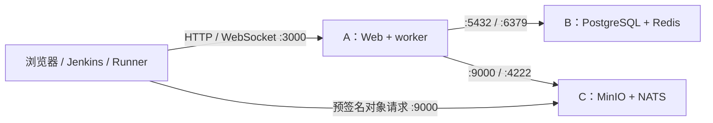

# Full 三主机部署方案（直连，无 Nginx）

**三台都是 amd64、希望直接改配置启动时，使用[三机快速部署](../../../../fast-deploy/README.md)。**
该目录每台主机只有 Compose 和 `.env.example`，不需要运行配置生成或部署脚本。

本方案复用上一级的独立组件 Compose，把 Full 的组件分配到三台主机。
浏览器、Jenkins 和 Runner 直接访问平台端口；持久数据全部绑定宿主机本地目录，
不使用 Docker named volume，也不启动 Nginx。

## 1. 机器分配

| 主机 | 示例 IP | 常驻容器 | 宿主机数据目录 |
| --- | --- | --- | --- |
| A：平台 | `10.20.0.11` | Web、dispatcher worker | `/srv/autoforge/platform` |
| B：数据库与缓存 | `10.20.0.12` | PostgreSQL、Redis | `/srv/autoforge/postgres`、`/srv/autoforge/redis` |
| C：对象存储与消息 | `10.20.0.13` | MinIO、NATS JetStream | `/srv/autoforge/minio`、`/srv/autoforge/nats` |

Web 与 worker 在 A 上使用两个容器、共享同一个本地平台目录，分别处理请求和后台调度。
PostgreSQL 与 Redis 位于 B，避免数据库与平台计算争抢同一主机资源；MinIO 与 NATS 位于 C。
条件允许时，C 的 MinIO 与 JetStream 数据目录分别放到不同的物理数据盘，减少磁盘写入竞争。
平台本地目录仍保存执行日志、配置与密钥，不能因为使用 Full 就省略或不备份。

三台主机应保持时钟同步，并使用稳定的内网 IP。以下地址都需替换为实际地址。
这里的三台是平台与基础设施主机，执行用例仍使用已有独立 Runner 节点；
如果总共只有三台机器，应另行评估 JVM 执行与平台、数据库共机时的资源预留。
本方案使用单平台、单实例基础设施，不提供主机故障自动切换。

需要把执行日志正文写入 PostgreSQL 时，可在 C 增加[独立日志 PostgreSQL 组件](../log-postgres/README.md)，
默认使用 `5433`、独立凭据和本地目录，与 B 的业务数据库分开。此时 C 还需导入相同的 PostgreSQL 离线镜像，
并允许 A 访问日志端口；MinIO 与原平台本地历史日志仍保留。资源与磁盘不足时使用独立日志主机。



该入口是受控内网 HTTP，后端容器不直接提供 TLS。如果要求 HTTPS，应使用已有企业 TLS 入口；
无需为本方案新增 Nginx。使用 HTTPS 时，MinIO endpoint 也应配置为共同可达的 HTTPS 地址，
避免浏览器混合内容限制。

## 2. 网络与端口

| 目标 | 端口 | 允许访问方 |
| --- | --- | --- |
| A：平台 | TCP `3000` | 用户浏览器、Jenkins、Runner、运维终端 |
| B：PostgreSQL | TCP `5432` | A |
| B：Redis | TCP `6379` | A |
| C：NATS | TCP `4222` | A |
| C：MinIO S3 API | TCP `9000` | A、Runner、用户浏览器 |

跨主机连接填写上述 IP，不填写 `localhost`、`postgres`、`redis`、`nats` 或 `minio` 等
仅在单个容器网络中有效的名称。Docker 发布的端口需由实际生效的宿主机／网络防火墙限制来源。
不对宿主机发布 worker `3001`、NATS 监控 `8222` 和 MinIO 控制台 `9001`。
直连平台的 `3000` 同时承载页面、API、日志和 WebSocket，不需要另开日志或终端端口。

## 3. 模板与离线镜像

从当前源码取得 `deploy/compose/full-bind/` 和凭据生成器
`deploy/compose/distributed/infrastructure/prepare-secrets.mjs`。
下文约定部署根目录为 `/opt/autoforge-deploy/`，保留以下相对路径：

```text
/opt/autoforge-deploy/
├── full-bind/
│   ├── platform/       # A 使用
│   ├── postgres/       # B 使用
│   ├── redis/          # B 使用
│   ├── minio/          # C 使用
│   └── nats/           # C 使用
└── distributed/infrastructure/prepare-secrets.mjs  # A 上生成凭据
```

每台机器只需保留对应的组件目录；A 额外保留凭据生成器。各组件依然独立启动，
两台主机上的两个组件不需要合并成一个 Compose，也不依赖 Docker 跨主机网络。

以 `amd64` 和正式平台 `v1.21.0` 为例，镜像分配如下：

| 主机 | 离线 Docker tar |
| --- | --- |
| A | `autoforge-backend-1.21.0-amd64.docker.tar` |
| B | `autoforge-infra-postgres-15-alpine-amd64.docker.tar`、`autoforge-infra-redis-7-alpine-amd64.docker.tar` |
| C | `autoforge-infra-minio-RELEASE.2025-04-22T22-12-26Z-amd64.docker.tar`、`autoforge-infra-minio-client-RELEASE.2025-04-16T18-13-26Z-amd64.docker.tar`、`autoforge-infra-nats-2.14.3-alpine3.22-amd64.docker.tar` |

主平台镜像来自[正式 v1.21.0](https://github.com/iskycc/auto-forge/releases/tag/v1.21.0)，
其余五个镜像来自[基础设施临时包](https://github.com/iskycc/auto-forge/releases/tag/v1.20.22-infra.20261027.1)。
不下载 Nginx 镜像。MinIO Client 只用于一次性创建 `autoforge-objects` bucket，完成后退出；
离线主机保留该镜像，供以后再次初始化。校验步骤遵循各自 Release 的说明，
正式包签名与临时包 SHA-256 校验不能相互替代。

使用 `docker load --input 文件名` 导入本机所需镜像。基础设施临时包还需取得
`autoforge-infra-compose-overrides-amd64.tar.gz`，在 B、C 的 `full-bind/` 中分别解出所需覆盖文件：

```bash
# B
tar -xzf /media/offline/autoforge-infra-compose-overrides-amd64.tar.gz \
  postgres/compose.offline.yml redis/compose.offline.yml

# C
tar -xzf /media/offline/autoforge-infra-compose-overrides-amd64.tar.gz \
  minio/compose.offline.yml nats/compose.offline.yml
```

以下基础设施命令始终同时传入 `docker-compose.yml` 和 `compose.offline.yml`，
使用已校验的本地架构镜像 tag；缺少镜像时直接报错，不在线拉取。
A 的正式后端镜像不使用该覆盖文件。更换平台版本时，同步修改文件名和平台 `.env` 中的版本。

## 4. 目录与凭据

以下主机配置命令使用 root 执行，或按本机权限加 `sudo`。先创建数据目录：

```bash
# A：官方平台容器以 1000:1000 运行
install -d -o 1000 -g 1000 -m 0700 /srv/autoforge/platform

# B：镜像 entrypoint 会初始化数据库目录属主
install -d -m 0700 /srv/autoforge/postgres /srv/autoforge/redis
install -d -m 0700 /srv/autoforge/secrets

# C
install -d -m 0700 /srv/autoforge/minio /srv/autoforge/nats
install -d -m 0700 /srv/autoforge/secrets
```

使用实际数据盘时修改目录和对应 `.env`，不要把磁盘挂载根目录直接作为数据库目录。
保持源目录事先存在，不使用 `chmod 777`；SELinux 主机按本地策略设置容器可访问的目录标签。

在 A 的 `/opt/autoforge-deploy/full-bind/` 下生成一次凭据，无需安装宿主机 Node.js：

```bash
umask 077
install -d -m 0700 /secure/autoforge-bootstrap
docker run --rm --pull never --network none --user 0:0 \
  --mount "type=bind,source=$PWD/../distributed/infrastructure,target=/templates,readonly" \
  --mount type=bind,source=/secure/autoforge-bootstrap,target=/output \
  autoforge/backend:1.21.0-amd64 \
  node /templates/prepare-secrets.mjs /output/secrets
```

将以下文件通过受控方式分别传到 B、C 的 `/srv/autoforge/secrets/`，文件权限 `0600`，
目录权限 `0700`。生成器拒绝覆盖已有目录，不要在 B、C 重新生成另一套密码。

| 主机 | 分发文件 |
| --- | --- |
| B | `postgres-password`、`redis.conf`、`redis-password` |
| C | `nats.conf`、`minio-root-user`、`minio-root-password` |

A 的准备目录保留原始凭据，供初始化填写；NATS token 取 `nats-token` 文件。
平台 `.env` 不写数据库密码、NATS token 或 MinIO 密钥。

## 5. 各组件的 .env

在各自组件目录把 `.env.example` 复制为 `.env`，按下列内容配置。
所有 bind 地址填写当前主机实际拥有的 IP；这里把同机组件都绑定到同一个内网 IP。

**A：`platform/.env`**

```dotenv
AUTOFORGE_BACKEND_IMAGE=autoforge/backend:1.21.0-amd64
AUTOFORGE_NODE_BIND=10.20.0.11
AUTOFORGE_HTTP_PORT=3000
AUTOFORGE_PLATFORM_DATA_DIR=/srv/autoforge/platform
AUTOFORGE_WEB_CPUS=0
AUTOFORGE_WEB_MEMORY_LIMIT=0
AUTOFORGE_WORKER_CPUS=0
AUTOFORGE_WORKER_MEMORY_LIMIT=0
```

CPU／内存的 `0` 表示由主机可用资源决定，不表示预留了相应资源。需要限制时按实际负载配置；
这些是平台容器资源参数，与 Runner 的任务并发和内存调度策略分别管理。

**B：`postgres/.env`**

```dotenv
AUTOFORGE_SERVICE_BIND=10.20.0.12
AUTOFORGE_POSTGRES_PORT=5432
AUTOFORGE_POSTGRES_DATA_DIR=/srv/autoforge/postgres
AUTOFORGE_SECRETS_DIR=/srv/autoforge/secrets
```

**B：`redis/.env`**

```dotenv
AUTOFORGE_SERVICE_BIND=10.20.0.12
AUTOFORGE_REDIS_PORT=6379
AUTOFORGE_REDIS_DATA_DIR=/srv/autoforge/redis
AUTOFORGE_SECRETS_DIR=/srv/autoforge/secrets
```

**C：`minio/.env`**

```dotenv
AUTOFORGE_SERVICE_BIND=10.20.0.13
AUTOFORGE_MINIO_PORT=9000
AUTOFORGE_MINIO_DATA_DIR=/srv/autoforge/minio
AUTOFORGE_SECRETS_DIR=/srv/autoforge/secrets
```

**C：`nats/.env`**

```dotenv
AUTOFORGE_SERVICE_BIND=10.20.0.13
AUTOFORGE_NATS_PORT=4222
AUTOFORGE_NATS_DATA_DIR=/srv/autoforge/nats
AUTOFORGE_SECRETS_DIR=/srv/autoforge/secrets
```

## 6. 启动顺序与 Full 初始化

先在 B 的 `postgres/`、`redis/` 和 C 的 `minio/`、`nats/` 中，分别执行：

```bash
docker compose -f docker-compose.yml -f compose.offline.yml config --quiet
docker compose -f docker-compose.yml -f compose.offline.yml up --detach
docker compose -f docker-compose.yml -f compose.offline.yml ps --all
```

四个常驻服务应健康；C 的 `minio-init` 应为 `Exited (0)`。
若初始化失败，在 `minio/` 中运行
`docker compose -f docker-compose.yml -f compose.offline.yml logs minio-init` 查看原因。
不同组件使用独立 Compose 项目名，同机不会发生容器或网络名称冲突。

之后在 A 的 `platform/` 下只启动 Web：

```bash
docker compose config --quiet
docker compose up --detach web
```

从 A 的 `/srv/autoforge/platform/config/initial-admin-token` 安全读取初始令牌，
浏览器打开 `http://10.20.0.11:3000/setup`，在“运行模式初始化”选择 Full 并填写：

| 配置项 | 值 |
| --- | --- |
| PostgreSQL URL | `postgres://autoforge:<postgres-password>@10.20.0.12:5432/autoforge` |
| Redis URL | `redis://:<redis-password>@10.20.0.12:6379` |
| NATS servers | `nats://10.20.0.13:4222` |
| NATS token | A 准备目录中 `nats-token` 的内容 |
| MinIO endpoint | `http://10.20.0.13:9000` |
| MinIO access key / secret key | `minio-root-user`／`minio-root-password` 的内容 |
| MinIO bucket / region | `autoforge-objects`／`us-east-1` |
| Web 监听 | `0.0.0.0:3000` |
| worker 健康端口 | `3001` |
| 平台外部访问地址 | `http://10.20.0.11:3000` |
| Runner 内部访问地址 | `http://10.20.0.11:3000` |

地址中的尖括号占位替换为对应密码；生成器的密码可直接用于 URL，
自定义密码包含特殊字符时需 URL 编码。保存配置后重启 Web：

```bash
docker compose restart web
curl --fail http://10.20.0.11:3000/api/v1/health/ready
```

重启后回到 `/setup`，使用初始令牌创建 Full 数据库中的首位管理员。
确认成功后，启动独立 worker：

```bash
docker compose --profile worker up --detach worker
docker compose --profile worker ps --all
```

平台配置保存在 A 的 `config/platform.json`，由同机 Web／worker 共读；
不拆到另一台机器，也不通过 NFS 共享日志 SQLite。
MinIO endpoint 必须同时能被 A、Runner 和用户浏览器访问。
已注册 Runner 如果仍指向旧平台地址，需要同步其控制面地址；
平台的 Runner 地址设置用于之后的安装／重新安装，不会自动改写已有 Agent 配置。

## 7. 验收、升级与备份

部署后依次验证：

1. 从浏览器、Runner 所在网络访问 A 的 readiness；从浏览器／Runner 网络访问
   `http://10.20.0.13:9000/minio/health/live`。
2. 登录后确认平台运行模式为 Full；Web、worker 和四个基础设施服务健康，MinIO 初始化成功退出。
3. 注册一个 Runner，导入一个普通用例和一个 DDT 用例，执行小任务，检查实时日志、终态和产物上传／下载。
4. 打开公开日志及公开执行进展链接，确认生成的地址是 A 的直连地址，新标签页、重跑和 WebSocket 正常。
5. 在维护窗口逐个重建容器，确认原项目、历史执行、日志和对象仍可访问，再按业务规模逐步增加负载。

升级时先完成一致备份，在 A 停止 worker，导入并切换新版 Web，确认迁移与 readiness，
再用同版本镜像启动 worker。基础设施的启停始终保留两个 `-f` 参数。

备份至少覆盖 B 的 PostgreSQL、C 的 MinIO、A 的完整平台目录和相关凭据，
在暂停写入、停止 Web／worker 的同一个窗口生成一致集合。
冷拷贝数据库或对象存储原始目录时还需停止相应服务；不能直接复制运行中的数据目录。
Redis、NATS 不能代替业务备份；单机 Full 备份脚本不适合直接收集三台机器的数据。
详细操作边界见[父部署说明的备份章节](../README.md#6-升级迁移已有卷与备份)。

2026-10-27 已按本页五份 `.env` 对平台（含 worker）和四个基础设施模板执行 Compose 解析，
并叠加临时离线包的实际覆盖文件；检查了主机 IP、发布端口、bind 路径及禁止自动拉取设置。
文档 Shell 语法、相对链接和部署包构建测试通过，新文档已确认会被打入部署归档。
本次未启动服务；三台物理主机的互访、真实 Runner 闭环和生产容量仍须在目标环境按以上步骤验收。

## PostgreSQL 数据卷容量采样

新版 fast-deploy/node-b、fast-deploy/log-postgres 与 full-bind/log-postgres 模板的 PostgreSQL 健康检查内置 `df -Pk "$PGDATA"` 采样，无需另外运行脚本。平台设置的“日志数据库 → 查看容量”和主库诊断可显示该数据卷实际剩余空间；旧部署需更新对应健康检查并重建容器，保留原 bind 数据目录。缺失、权限不足或超过两分钟的采样不会显示成当前有效空间。外置 tablespace／WAL 文件系统需单独监控，详见[Full 三主机运行链路与容量诊断](../../../../docs/architecture/full-three-host-runtime-audit.md)。
