# Worker AI 初步用例分析：需求与实现指导

状态：**v1.21.25 优化同栈归类与 stdout 证据范围；发布状态以 GitHub Release 为准**。更新日期：2026-11-06。

本轮现行要求以[提示词与输出契约](./ai-failure-analysis-prompts.md)和[使用说明](../operations/ai-analysis.md)为准：批次相同完整堆栈统一一个疑似问题；同栈不足 10 例时逐例采集 stdout，达到 10 例才共用堆栈。单例也读取 stdout，排除通用错误码及 stderr／Agent 诊断。2026-11-06 新规则：模型证据先清理颜色／终端控制序列，不再额外脱敏；业务字符串在 50,000 个 Unicode 字符内保留全文，超过时以末尾 25,000 字符为基准向前补齐首行；日志按完整 stdout 正文判断，JSON 按字段值处理。完整堆栈只用于平台归类，不因尾部相同而误合并；模型明确知道尾部裁剪，不得声称看过被省略的全文。原始日志保持不变。结论只展示一种初步分类及简短原因、依据。后台可维护多条参考提示，每次分析附带。失败分析导出的 AI 列紧接失败堆栈，尚未产出结论的行留空。

下文保留首版设计背景，涉及“逐例推理后再组内归并、长篇原因／反证／排查步骤”的旧设计已被上述本轮规范取代；多模态、历史工具、完整逐 occurrence 建模等规划不能视为已经实现。模型没有执行或人工分析权限，仍只维护独立 AI 草稿。

## 1. 目标与交付边界

给平台 Worker 增加可关闭的 AI 初析能力：冻结一次执行的最终失败范围，收集有权限读取的完整执行证据，按相同堆栈确定性分组，把每组的全部用例及证据分片交给模型，生成带依据、待确认事项和排查步骤的初步建议。

界面入口称为“AI 初步分析”，配置分类称为“模型配置”。AI Agent 指平台内部的分析编排器，**不是执行机上的 Go Runner Agent**。它只能读取分配给它的执行证据，并通过唯一受控写工具提交本次初析结论草稿；不能改变执行结果、认领或完成人工分析，也不能执行用例、操作 Jenkins、提交问题单或运行命令。

首版必须交付：

1. 手动发起、查看进度、取消、失败恢复及重新分析。
2. 普通 TestNG、DDT 和混合任务的最终失败证据读取接口。
3. 完整堆栈的精确分组，以及缺失／不完整堆栈的明确处置。
4. 全部成员的分片分析、组内合并、批次汇总；不能仅分析代表用例就标为整组完成。
5. 原因假设、依据引用、不同用例的例外情况、排查步骤和证据不足说明。
6. Lite／Full 共用规则和契约，资源保护、权限、输入处理、预算及审计完整。

首版不建设向量数据库，不依赖公网模型、联网搜索或通用自主执行框架；相似堆栈的语义合并、多模态截图识别、跨项目知识检索及自动修复留到后续设计。

## 2. 当前代码基线及不能直接复用的部分

| 已有能力                   | 代码依据                                                                                                                                                        | 本功能的接入要求                                                                         |
| -------------------------- | --------------------------------------------------------------------------------------------------------------------------------------------------------------- | ---------------------------------------------------------------------------------------- |
| 人工认领、分类、证明及归档 | [FailureAnalysisService](../../packages/application/src/manage-failure-analysis.ts)、[人工分析契约](../../packages/contracts/src/failure-analysis.ts)           | AI 建议独立保存，不创建虚假的人工进展                                                    |
| 总结的最终结果选择         | [finalRunOutcome](../../packages/db/src/final-failure-selection.ts)、[批次计数](../../packages/db/src/run-batch-counts.ts)                                      | 提取共享语义，经 Lite／Full 契约测试保持同一口径                                         |
| 人工分析候选查询           | [SQLite 实现](../../packages/db/src/sqlite-failure-analysis.ts)、[PostgreSQL 实现](../../packages/db/src/postgres-failure-analysis.ts)                          | 当前人工清单限定批次当前轮次且结果 failed；不得当作全批次最终失败的通用接口              |
| 失败列表摘要               | [failure-analysis-shared.ts](../../packages/db/src/failure-analysis-shared.ts)                                                                                  | 展示最多 8,192 字符，不能作为完整堆栈或全量证据                                          |
| 统计失败签名               | [failureSignature](../../packages/db/src/platform-operations-shared.ts)                                                                                         | 会替换数字／ID、压缩空白并截断到 160 字符，不能直接用于精确堆栈分组                      |
| TestNG 结构化结果          | [执行契约](../../packages/contracts/src/execution.ts)                                                                                                           | 有计数、方法状态和 detailsTruncated；当前方法 DTO 不含完整异常堆栈，不得假定可以直接读取 |
| 日志与执行快照             | [应用端口](../../packages/application/src/ports.ts)、[日志路由与归档](../operations/log-archives.md)                                                            | 复用受控读取，记录水位、缺失及离线归档状态                                               |
| 持久队列与 Worker          | [JobEnvelope](../../packages/contracts/src/jobs.ts)、[JobWorker](../../packages/application/src/run-job-worker.ts)、[Full 入口](../../apps/worker/src/index.ts) | 新增专用 AI 工作车道，业务编排放在 application                                           |
| 资源隔离与退让             | [运行资源优先级](./runtime-resource-priority.md)、[读模型复查](./read-model-snapshots.md)                                                                       | 不占用执行控制、日志上传、页面等待统计的工作线程                                         |

实现时必须重新核对这些代码，而不是复制本文描述成第二套结果判定。

## 3. 最终失败范围：拟定口径 final_failed_v1

### 3.1 默认范围

- 人工整批初析只接受已结束的标准任务执行批次，批次状态可为 succeeded、failed 或 cancelled。自动初析可在最终轮次期间分批接收已经结束且不再重试的失败成员，批次结束后关闭接收。
- 依据平台“总结”的最终结果：同批次任一次通过则该用例最终通过；否则取最后一次尝试的结果，缺少尝试时回退到权威执行记录的终态。与当前 finalRunOutcome 保持一致，不擅自改成“最大轮次中的失败”。
- 选择最终结果为 failed 或 timed_out 的用例。取消、未执行、通过不进入失败分析集合，但在范围摘要中分别计数。
- 不跨批次合并结果。后续公开日志重跑通过不改写原批次结果，可作为明确标注来源的补充证据。
- 排除 case_log_rerun、单用例调试及其他非标准批次；将其作为独立分析来源需要另行扩展 scopePolicyVersion。
- 任务被删除时，只要执行快照仍可读取且权限有效，仍可分析，不依赖当前任务配置或当前 DDT 正文。

示例：初始失败后本批次重跑通过的 A 排除；第三轮仍失败的 B 纳入；只执行到第二轮后停止、最终结果仍为 failed 的 C 也纳入。C 不必出现在批次最后一轮。整个批次已停止但仍有最终失败用例时，可以分析这些已有结果。

### 3.2 与人工分析清单的关系

AI 候选数应等于同一事实代次的“总结失败数＋总结超时数”，不保证等于现有人工分析页的“当前轮次 failed”数量。两者口径差异必须在界面说明。**不修改原人工分析、失败任务复制或执行历史的筛选规则**。

新建 AI 作业无需隐式开启人工认领任务；若已有人工分析记录，其状态和结论只作为有来源的参考。对已归档的人工分析入口保持只读，首版不在该入口自动发起新的初析。

### 3.3 范围冻结

人工整批作业先记录 batchId 与终态来源，再异步分页建立候选清单。自动作业在执行期间按终态成员持续接收，持久清单负责去重；批次结束后才关闭接收，不以整个活动批次的版本变化废弃已经分析的成员。清单至少包含 executionRunId、选中的 attemptId／结果回退原因、最终结果和执行时用例版本。

清单建立过程中不得维持长事务。每页校验批次代次，完成后校验数量与摘要；出现变化则作废该生成代次并有界重建，不拼接不同版本。以冻结清单为后续成员枚举依据，不随当前筛选或人工认领状态变化。

候选、最终尝试及执行输入通过有索引的窗口批量读取，不逐用例重复扫描整个批次的全部轮次。清单和分组索引持久化；证据解析、签名和分片计划按页／流推进，不把十万用例及全部日志装入 Worker 内存，也不为全部成员一次创建无界 Promise。

没有失败候选时返回明确的空结果，不调用模型。没有 attempt 的最终失败项仍保留，但标记“无实际尝试证据”，不得伪造日志和堆栈。

## 4. 总体链路

```mermaid
flowchart LR
    U[授权用户发起智能初析] --> A[应用服务保存作业和工作计划]
    A --> Q[SQLite 队列或 Full outbox / JetStream]
    Q --> W[Worker 专用 AI 车道]
    W --> S[冻结清单与证据快照]
    S --> G[精确堆栈分组]
    G --> M[全部成员分片与预算预留]
    M --> L[模型适配器与只读工具桥]
    L --> V[结构校验 / 引用校验 / 覆盖核对]
    V --> R[组级建议与批次报告]
    R --> H[人工查看 / 确认 / 引用建议]
```

模型不是数据库或队列消费者。模型提出工具调用，由 Worker 在绑定的作业上下文中执行；模型不能直接持有平台 API Key、数据库凭据或任意网络访问权。

建议阶段：`freeze_candidates → collect_evidence → cluster_stacks → plan_shards → analyze_shards → reduce_groups → summarize_batch → publish_report`。每阶段均有持久检查点和可恢复的工作项。

## 5. “所有数据”的定义与证据读取

“所有数据接口”指可按冻结范围遍历的完整可用证据，而不是一个返回整批所有日志的巨型 JSON。完整采集、清理后可用、模型实际读取是三个独立状态，必须分别计数。

| 证据           | 必须提供的内容                                                               | 读取与缺失约定                                                           |
| -------------- | ---------------------------------------------------------------------------- | ------------------------------------------------------------------------ |
| 批次／任务快照 | 原任务标识及版本、执行策略、最终结果口径、轮次、实际环境、时间与执行发起信息 | 使用执行时快照，凭据、恢复密钥及退役执行密文字段不得进入证据包           |
| 用例执行输入   | 普通用例类路径／执行方法／版本；DDT CaseID、SR、完整动态字段及旅程步骤       | 按实际执行快照读取，禁止拿当前已编辑正文替代；保留值类型与空值状态       |
| 最终尝试       | attemptId、逻辑轮次、物理尝试序号、结果码、摘要、耗时及状态事件              | 选择过程可审计，不能把调度重试误当逻辑重跑                               |
| 异常与堆栈     | 完整可取得的异常链、Caused by、Suppressed、断言文本、方法位置                | 优先用明确存在的原始报告／异常正文；不得假定当前 TestNG DTO 含堆栈       |
| 日志           | stdout、stderr、Agent 诊断，各自顺序、水位、时间与完整性                     | 分流分页读取；从可用在线或平台归档副本读取，不能自动恢复已删除的离线数据 |
| 节点与环境     | 执行节点、版本、JDK／依赖摘要、失败前后已有资源与调度事件、实际环境关联      | 仅使用当时已持久化数据，不能以当前 CPU／内存推断历史资源不足             |
| 产物           | 报告、截图等清单、类型、大小、SHA-256 与读取权限                             | 文本报告可分块解析；首版不声称理解图片、视频、任意 JAR 内容              |
| 历史与人工信息 | 同任务同用例最近 5 次执行／已完成人工结论、公开日志重跑证明                  | 默认不跨项目／任务取知识；历史结论是参考，不自动继承或覆盖               |

所有证据记录 `evidenceId、sourceKind、attemptId、sourceRevision/watermark、mediaType、sizeBytes、sha256、inputPolicyVersion、availability`。文本分块再记录 partId、行／字节范围及摘要，模型引用必须落到已下发的具体块。

availability 至少区分 available、absent、truncated、archived_offline、forbidden、unsupported、read_failed。不能把权限不足、读取超时或归档副本已删除解释成“没有异常”。不完整日志或报告必须进入报告的缺失项。

超大单用例 JSON 按 JSON Pointer 分块，超大日志按固定水位分块；完整性由清单和摘要保证。文本解析禁止执行上传内容，拒绝 XML 外部实体、越界解压和对象路径穿越。可用结构化异常不足时，可从日志提取，但必须记录提取算法、来源区间及是否完整。

## 6. 拟议 HTTP 与 Agent 工具契约

### 6.1 人工入口

以下路径均为**待实现**，统一 `/api/v1`，入口解析 Zod、鉴权后调用应用服务。

| 方法与路径                                                            | 用途                                                   |
| --------------------------------------------------------------------- | ------------------------------------------------------ |
| POST `/api/v1/ai-analyses`                                            | 创建作业；必填 batchId，作用域由服务器解析；使用幂等键 |
| GET `/api/v1/ai-analyses/{analysisJobId}`                             | 进度、阶段、覆盖率、预算、缺失证据及失败原因           |
| POST `/api/v1/ai-analyses/{analysisJobId}/cancel`                     | 请求取消，校验作业版本，不影响执行批次                 |
| GET `/api/v1/ai-analyses/{analysisJobId}/groups`                      | 游标分页查询分组与建议摘要                             |
| GET `/api/v1/ai-analyses/{analysisJobId}/groups/{groupId}/members`    | 分组全部成员的游标页                                   |
| GET `/api/v1/ai-analyses/{analysisJobId}/report`                      | 已发布报告摘要及有界详情入口                           |
| GET `/api/v1/ai-analyses/{analysisJobId}/evidence/manifest`           | 冻结证据目录和完整性信息                               |
| GET `/api/v1/ai-analyses/{analysisJobId}/cases`                       | 冻结失败候选的游标页                                   |
| GET `/api/v1/ai-analyses/{analysisJobId}/cases/{executionRunId}`      | 单用例证据索引；大正文返回分块引用                     |
| GET `/api/v1/ai-analyses/{analysisJobId}/evidence/{evidenceId}/parts` | 有界读取处理后的证据块                                 |

列表默认 50、最大 100 条；证据块建议不超过 128 KiB，响应上限建议 512 KiB。游标绑定作业、输入生成代次、筛选和授权范围，不使用大 OFFSET；页末返回 nextCursor。超过正文限额返回可操作的分块指引，不偷偷截断后标记完整。

创建接口只提交并返回 `202 + analysisJobId`，不等待堆栈扫描、模型请求或报告生成。重复幂等键及同一请求体返回原作业；键相同而输入不同返回冲突。显式“重新分析”创建新作业版本，保留旧报告。

### 6.2 提供给大模型的工具

工具由平台适配器映射到上述应用服务／受控 HTTP，参数不含任意 URL、SQL、文件路径或认证头。

| 工具                 | 参数边界                                  | 输出                                     |
| -------------------- | ----------------------------------------- | ---------------------------------------- |
| `list_group_members` | 只允许当前组与工作片、绑定游标、limit≤100 | 本片成员的分页目录及组／片 expectedCount |
| `get_case_evidence`  | 只允许当前工作片中的 executionRunId       | 执行输入、最终结果和证据清单             |
| `read_evidence_part` | 只允许当前上下文 evidenceId、partId       | 内容、来源、水位、摘要及完整性           |
| `read_case_history`  | 当前任务／用例，最多最近 5 次，分页       | 历史结果及可引用证据                     |

模型收到工具描述，不收到读取令牌。作业、项目、版本、批次及分片上下文由 Worker 注入，服务端再次验证成员归属。平台 HTTP 可分页遍历全组，模型工具限定当前工作片；全部成员由工作计划分配，不能让单次模型调用无界遍历整组。Full Worker 可直接调用相同应用服务及端口，避免把全量读取压回 Web；HTTP 契约用于受控跨进程接入和调试，两种路径必须有一致的契约测试。

首版不提供 shell、SQL、任意 HTTP、重跑、终止执行、修改用例、修改人工结论等工具。模型生成的链接或参数不是授权依据。

## 7. 相同堆栈的分组规则 exact_stack_v1

1. 在冻结的最终失败尝试中提取失败 occurrence。一个类可能有多个方法失败、配置失败或异常链，不可只取第一条。
2. 每个 occurrence 记录方法／报告位置、异常类型、完整异常链和堆栈来源。优先解析明确存在的报告，再读取实际可用异常正文或日志；展示摘要只可作为线索。
3. 规范化仅统一换行及已确认的纯展示 ANSI 控制序列。保留异常类型、断言期望／实际值、方法、业务栈帧、源码行号、Caused by／Suppressed 及顺序。首版不替换数字、IP、UUID或业务输入，不移除全部框架栈帧来强行合并。
4. 对完整规范化堆栈生成带项目／批次命名空间的签名，记录 signatureVersion。包含敏感内容的签名采用服务端 HMAC，不向模型暴露可枚举的原文摘要。AI 证据包保留源业务文本，不再执行额外的密码／Token 替换；按现行规则清理颜色和限制长度。
5. 相同签名还需核对可比的完整堆栈文本及提取版本，避免碰撞或不同输入处理版本混组；不通过替换业务值或凭据强行合并不同堆栈。
6. 只有可确认完整的相同堆栈进入精确组。前 8,192 字符相同、后半段不同必须分组；缺失／截断堆栈不能统一放进一个“相同错误”组，按独立未分类项保留。

一个用例可属于多个异常组，因此分组成员数之和可能大于失败用例数。批次覆盖按不同 executionRunId 计算；组内按 `(executionRunId, attemptId, occurrenceId)` 去重，不能仅用显示名或 DDT CaseID 去重。

“堆栈相同”只是错误表现一致，不等于已经证明共同根因。环境、输入、时间或历史表现不一致时，模型应提出组内例外或不同假设，不能把首个用例的结论套给全部成员。

## 8. 所有成员送模：分片、合并与覆盖证明

必须区分：成员已枚举、证据已采集、证据已下发、模型已完成分析。只下载完整证据包不代表模型看过全部数据。

- 每组先产生完整成员 manifest，固定总数、成员索引和证据摘要。公共堆栈可在每次必要上下文中复用一次，成员引用此公共证据，不能因去重而删除成员独有的数据。
- 每个成员的执行输入、结果、堆栈及可用文本证据按预算组成分片；成员很多或单个成员过大时继续拆分。所有分片必须进入模型工作计划，不允许“取前 20 个”后宣称整组完成。
- 分片上限同时受字节、输入 token、输出预算和成员数约束。成员数只是上限；还要为逐成员结论与引用预留输出空间。tokenizer 不可用时采用保守估算，提供方拒绝超长请求后进一步分片，不能无界重试。
- 采用 `分片分析 → 组级合并 → 批次汇总`。组级合并读取全部成功分片结果，验证成员覆盖与冲突；若合并输入仍超限，继续分层，保留每层的成员范围及证据引用。
- 原始可用证据均可通过接口遍历。默认计划覆盖全部必需文本证据；主动摘要、证据筛选、未读取大日志、已离线日志、图片未识别等情况必须明确标记，不能称为“所有证据已分析”。
- 组完成需满足完整成员枚举、必需证据处理完成、全部工作片成功、输出与引用有效、无遗漏成员。无法满足则为 partial；证据不足的建议标记 needs_evidence，该标记不是另一种作业状态。预算用尽必须保存未完成清单，不以少量代表样本补齐进度。

报告至少展示 `totalCases、enumeratedCases、evidenceReadyCases、modelProcessedCases、reportedCases、missingEvidenceCases、unprocessedCases、totalGroups、completedGroups`，并区分成员集合和 occurrence 集合。累计数由平台计算，不采信模型自己声称的覆盖率。

同一用例的全部必需证据片、全部 occurrence 都处理并校验后，才计入完整 modelProcessedCases；部分建议仍可出现在 reportedCases，但必须带不完整标记。覆盖核验只能证明数据下发、工具读取及有效结果的范围，不能证明模型正确理解了每条证据，更不能代替根因正确率验收。

支持至少十万候选的持久化规划、分组和完整分页，不设置低容量硬上限。十万成员能否在一次默认预算内全部送模取决于证据大小与分组数，不能以“任务支持十万条”承诺固定费用。开始前给出预计工作量；额度不足时允许明确增加预算或生成部分报告。

## 9. 模型输出和人工使用边界

每份组建议至少包含：

- 原始分组规则／范围、成员数、模型实际处理范围及缺失证据。
- 已观察事实、可能原因、相反证据、组内例外和待补证事项。
- 建议归类：产品问题、用例代码、环境依赖、测试数据、执行基础设施或无法判断。
- 每个假设的证据引用及置信等级；置信等级只表示模型自评，不是校准后的正确率。
- 有顺序的人工排查步骤，注明预期观察和验证方法；操作建议不自动执行。
- 模型、适配器、提示词、分组、输入处理版本，输入摘要、生成时间、调用次数和 token 用量。

AI 分类与人工 `rerun_passed / case_fixed / code_issue_filed` 不同。没有真实重跑证明不能说“重跑通过”，没有修复或问题单证据不能说“已修复／已提单”。模型建议保存为草稿，人明确采纳后再通过现有人工流程和证明校验提交。

输出必须用 Zod 验证：拒绝未知成员、伪造 evidenceId、越界行号、缺失字段、可执行 HTML／脚本字段、无效枚举及未完成的流式 JSON。普通文本按纯文本转义展示。结构修复最多一次，仍失败则该片失败；不能发布一段“看起来像答案”的字符串。模型的数量、状态和执行结果字段不得覆盖权威事实。

## 10. 持久化、队列、幂等与恢复

拟新增 `AiAnalysisJob、AiAnalysisWorkItem、AiFailureGroup、AiFailureGroupMember、AiAnalysisFinding`，均使用应用层 ID、UTC 时间及带版本条件的状态变更。

主库建议保存作业、状态、候选／成员索引、工作项、租约、预算预留、版本及小型结论；较大的证据包、输入／输出正文使用 ObjectStore，保存对象键、大小、摘要及媒体类型。Redis 不保存唯一事实。

| 作业状态   | 含义                                             |
| ---------- | ------------------------------------------------ |
| queued     | 已持久化，等待资源或数据准备                     |
| running    | 正在执行某阶段；另列当前阶段和等待原因           |
| cancelling | 停止新增模型请求，等待有限排空                   |
| cancelled  | 本次初析终止，已生成片段保留且不标完整           |
| completed  | 全部必需工作完成，覆盖与引用校验通过             |
| partial    | 有可用建议，但预算／证据／部分工作失败导致不完整 |
| failed     | 无法建立可信输入或没有可发布的分析结果           |

建议新增 `ai-analysis-wakeup` 队列 kind，沿用稳定的 messageId、runId、attempt、schemaVersion、createdAt 和 deduplicationKey。runId 遵循已有导入／导出后台作业的队列关联约定，取 analysisJobId；**不创建或冒充用例的 ExecutionRun**，源批次及成员引用放在独立字段和小型 payload 中。

队列只唤醒有界阶段。消费者先在短事务中登记或领取持久工作项，再 ack 唤醒消息；独立 AI 工作循环按数据库租约执行。必须同时实现到期工作项扫描和重新唤醒，避免 ack 后进程崩溃导致无人恢复。不得让同一条消息跨整个批次的所有模型调用一直保持未确认。

每个工作项有 workId、generation、leaseToken、leaseExpiresAt、attempts、nextAvailableAt。多 worker 原子条件领取并续租；发布校验作业版本、工作代次和租约。取消／租约失效后的晚到模型响应不能覆盖结果。

幂等键至少覆盖项目、来源输入摘要、scopePolicyVersion、signatureVersion、输入处理版本、提示词版本、模型配置修订、阶段和分片。模型调用在数据库事务之外进行；调用前持久化预算预留，收到结果后原子结算及发布。

提供方支持幂等请求时传稳定 requestId；不支持时，崩溃或超时可能造成重复推理费用，不能承诺模型端恰好调用一次。平台必须保证最终发布幂等，并对不确定费用保守占额。

网络超时、429、暂时性 5xx 有界退避；鉴权、配置、权限和证据格式错误不无限重试。资源退让不消耗业务失败次数。队列、作业和调用均有总期限与有限恢复次数，持续不可用时显示原因并进入 partial／failed。

### 10.1 证据生命周期与空间回收

AI 证据包是独立受管副本，不修改或删除原用例、执行记录、日志及归档。采集时绑定来源水位；与日志归档／清理并发时，只能使用有期限的受控读取引用，不能持有长事务或无限阻止清理。来源已不可读取时标记缺失，不悄悄改用当前用例正文或其他执行日志。

临时输入、分析证据和大模型输出均设置可配置保留期与字节配额；工作项间按内容摘要复用受管对象，引用归零后通过可重试对象清理任务删除。取消和失败也回收临时对象及预算预留。到期报告明确显示证据已过期，不保留无法解释的失效链接。

已有模型报告可能包含日志内容的衍生信息，必须按来源数据的权限与保留规则管理。平台可删除受管副本，但不能承诺撤回已发送到模型提供方的数据；模型服务的留存策略需管理员在接入前确认。诊断日志仅记录 ID、阶段、摘要、用量和脱敏错误，不记录完整模型请求／响应正文。

## 11. Lite／Full 与资源预算

| 事项           | Lite                                         | Full                                                          |
| -------------- | -------------------------------------------- | ------------------------------------------------------------- |
| 业务事实和租约 | SQLite，短写事务、条件领取、WAL              | PostgreSQL，短事务、条件领取、跨 worker 租约                  |
| 队列和崩溃恢复 | SQLite 持久队列＋过期工作项恢复              | 主库 outbox＋JetStream＋过期工作项恢复                        |
| 证据和大报告   | 本地 ObjectStore                             | MinIO ObjectStore                                             |
| 日志来源       | 既有本地／可读取归档                         | 既有独立日志库路由／可读取归档；不得新增 Full SQLite 日志写入 |
| 运行位置       | Web 管理的专用后台线程／进程                 | Worker 的专用 AI 车道，可配置仅承担 AI 的 Worker              |
| 进度缓存       | 可重建本地缓存                               | 可选 Redis，失效后读取主库                                    |
| 关闭功能       | 不创建模型客户端、不探测模型、不要求外部服务 | 不增加模型探测或 AI 消费；原 Full 基础服务要求不变            |

“给 Worker 增加 AI”不意味着让 Lite 启动现有仅面向 Full 的独立 Worker 入口。两种模式都调用 application 中同一个编排器，组合根注入各自端口。

建议初始资源配置如下，均为**待实现的建议值，需压测确定**：

- 全平台并行模型调用初始默认 2，可按模型服务额度调整；多个 Worker 不能把此值各当作独立额度，须用主库租约协调。同一作业也受此共享额度约束。
- AI 数据库连接单独设小预算，不借用执行控制连接池；读取分页 ≤100，写入按有界小批次提交。沿用现有查询／锁等待期限，不因 AI 放宽。
- 模型单次总期限建议 90 秒，暂时失败最多重试 2 次；取消通过 AbortSignal 贯穿网络、读取与解析。
- 单次模型请求建议 ≤2 MiB，输出预算建议 4,096 tokens；实际分片必须适配模型上下文及逐成员输出预算，不能只靠固定条数。
- 工具调用每工作片建议最多 20 次、模型交互最多 12 轮，超限转 needs_evidence，不能形成无限 Agent 循环。
- 作业必须有 token、请求次数、存储量和总时长预算，额度由项目／平台配置给出；费用单价仅使用管理员配置或提供方账单，不由模型猜测。
- AI 属低优先级后台工作，CPU、内存、数据库或日志通道拥塞时退让；执行续租、取消、完成、日志上传及页面等待快照不受其暂停。

模型服务建议部署在独立内网资源上。若同机部署，需独立 cgroup／容器配额和明确余量，禁止与平台无预算争抢内存。不能因为配置了多 Worker 就自动拉起同等数量模型请求。

## 12. 权限、输入范围与模型接入

默认关闭，管理员显式配置后才启用。优先接入已有内网模型服务；不预设厂商或模型名称，不在运行时下载模型、SDK、浏览器或容器镜像。模型不可用只影响初析，平台原有执行与分析照常工作，历史 AI 报告仍可读取。

拟新增 `analysis.ai.read / analysis.ai.create / analysis.ai.cancel` 项目权限，以及平台模型配置管理权限。开始分析还需当前项目的 run.read、case.read、log.read；读取受限产物额外校验 artifact.read。现有 analysis.manage 不应在升级时自动获得向外部模型发送数据的权限。

作业记录请求人的用户 ID、用户名快照和项目范围，不持久化浏览器 Cookie。每阶段和对模型披露新证据前重查账号、项目成员及数据权限；撤权后终止新读取，保留可审计的授权失败状态。人工采纳仍走原人工分析权限和证明要求。

报告、成员明细及证据下载也按当前权限校验，不能仅凭 analysisJobId 或 analysis.ai.read 绕过原始日志／产物权限。派生结论视为同等级敏感数据，不因为是 AI 生成就成为公开分享内容。

模型端点、认证密钥、模型标识、上下文能力、TLS 私有 CA、速率和预算集中配置并校验。密钥加密保存，输出 DTO 只含掩码；模型输入、日志和对象元数据中不能出现它。关闭功能时不能探测端点；连接检查由管理员手动执行且有界。

AI 采集不再额外脱敏，授权范围内的业务输入和 stdout 保留源值，仅清理颜色并按 50,000／25,000 字符规则处理；不还原原日志已经处理的内容。平台模型连接密钥、数据库和执行机管理凭据、恢复密钥不加入证据。默认不向公网发送数据；公网接入需要单独的显式数据披露配置和审计，不能因模型地址可填写就悄悄开放。

日志、用例正文、历史结论和模型输出均为不可信内容。提示词里的边界标记不是安全隔离：工具白名单、项目授权、SSRF 防护、正文／调用预算和输出校验必须在服务端强制执行。不得跟随证据中的 URL、加载外部图片、执行日志中的命令或接受模型自行声明的“管理员授权”。

## 13. 页面与人工交互要求（待实现）

复用现有 Ant Design 主题和“用例分析”详情，增加“智能初析”标签，不新增另一套界面风格。首次入口明确显示范围、模型、预计工作量、输入处理与预算；用户点击“开始初析”后异步展示进度。

组列表显示成员数、完整堆栈／未分类标记、AI 建议摘要、证据完整度和状态；详情展示共同堆栈、成员差异、证据引用、原因假设及验证步骤。成员、日志及大文本分页，不能渲染十万行 DOM。

必须明确区分：规则分组、AI 推测、平台已验证事实、人工已确认结论。部分结果和缺失证据醒目标注；模型自评高置信度不能使用“已确认根因”样式。取消初析不终止用例执行；“重新分析”保留旧版本，可比较差异。

“复制建议”只生成可编辑草稿，用户确认后才能填写人工分析；不自动设置 rerun_passed、case_fixed、code_issue_filed。没有权限时不显示原文和证据入口。

验收至少包括 1024×768、1536×960、浅色／深色的真实带数据截图；检查长堆栈、大组、预算暂停、网络失败、部分报告及嵌套弹窗，不能只依赖 DOM 断言。本轮已授权实现 UI，完成后必须提供实际截图和审查结论。

## 14. 模块拆分与实现顺序

| 模块                   | 拟承担职责                                                                           |
| ---------------------- | ------------------------------------------------------------------------------------ |
| packages/domain        | 最终失败范围策略、精确分组规则、工作状态机与预算不变量；不依赖模型 SDK 或数据库      |
| packages/contracts     | 作业／证据／工具／建议的版本化 Zod 契约与分页游标                                    |
| packages/application   | 创建作业、证据采集、工作规划、Agent 循环、校验、合并与发布；定义模型、仓储、证据端口 |
| packages/db            | Lite／Full 作业、候选、成员、工作项、预算与租约适配器及独立迁移                      |
| packages/queue         | AI 唤醒路由、幂等与恢复，两种队列共用契约                                            |
| 模型基础设施适配器     | 经审查后确定目录；实现 AiModelGatewayPort、能力声明、工具调用格式和 token／超时处理  |
| apps/web / apps/worker | 组合根、薄 HTTP 入口、专用工作车道、配置生命周期和 UI，不复制业务规则                |
| 版本化提示词资源       | System／分片／合并／汇总／修复模板及版本摘要，随离线包交付                           |

本轮不创建空包或占位路由。实现时新表建议按 job/project/batch、group/member 游标、work 状态与 availableAt／leaseExpiresAt 建必要索引，并审查全部外键清理路径。迁移序号在实际开发时分配，不在本文预占。

建议分四个可验收阶段：

1. **事实与规则**：冻结候选、完整证据接口、精确堆栈分组、双数据库一致性，不调用真实模型。
2. **受控模型编排**：模型端口、专用车道、分片、预算、工具桥、输出校验及可恢复工作项，使用离线 fake 验证。
3. **报告与人工接入**：全部成员覆盖、组／批次报告、权限、页面及人工草稿引用。
4. **真实内网模型验收**：脱敏黄金集评估、资源／故障／离线矩阵、部署和回滚说明，再决定是否开放按项目自动触发。

## 15. 必须落实的测试与验收

- 范围：先失败后通过、早期通过后其他尝试失败、较早轮次最终失败、超时、整批取消、未执行、任务删除、单用例重跑排除；AI 不改变原人工清单。
- 堆栈：CRLF／ANSI、嵌套 cause／suppressed、多个方法失败、8,192 字符之后的不同、断言值／行号不同、无堆栈、截断和业务原值保持。相同展示前缀不能误并组。
- 覆盖：十万成员、单个超大组、十万个小组、混合普通／DDT、超大输入、多层合并；没有任何成员或必要证据被静默遗漏，统计按 distinct run 计算。
- 契约：真实 SQLite／PostgreSQL、SQLite queue／JetStream、本地／MinIO；新建、升级、迁移失败回滚，日志路由及归档可用／离线状态。
- 恢复：重复唤醒、多个 Worker 领取同一片、模型响应后崩溃、工作租约过期、取消与发布竞争、预算预留回收及供应方可能重复计费。
- 安全：跨项目／成员越权、撤权、提示词注入、伪造引用、任意 URL／SQL／命令工具、模型超长输出、密钥出现在 DDT／日志／提示词／日志记录中的检查。
- 模型：有效 JSON、未知字段、缺失成员、引用越界、输出截断、结构修复仍失败；143 不能无证据判为 OOM，同栈异因必须保留例外。真实根因正确率通过脱敏黄金集制定目标，不以“高置信度”代替验收。
- 性能：13,001 用例×十轮、持续执行与日志上传、慢／失联模型、两个 Worker 同时初析；SQL 期限不放宽，不得因 AI 导致续租／完成失败或 Web 主线程阻塞。性能阈值以现有验收基线和实际部署预算制定并记录。
- 离线：关闭 AI 时断网启动并完成原有闭环；开启 AI 时只访问配置的内网模型，依赖均来自离线资产。模型服务停止不影响执行、人工分析或历史 AI 报告读取。

实现交付必须提供真实执行的命令、结果和截图，不把本文的验收清单当成已经完成的测试。

## 16. 实现前需要确认的部署参数

本文已给出可执行的默认设计，以下参数由接入环境确定：模型服务地址与协议能力、上下文大小、数据披露范围、请求／token／存储预算、自动触发策略、证据保留期和黄金集评分阈值。

默认决策保持：最终失败＋超时范围、批次内精确分组、全部成员分片覆盖、默认关闭、内网优先。手动批次／单例和任务末轮渐进自动初析均已接通；工具只读证据加写入本次 AI 结论草稿。模型并发是整个端点的共享预算，不随 Worker 数量无限放大；当前初始值为 2，可在后台调整。任何改变候选口径、执行权限或离线边界的方案，必须先更新本设计并按仓库规则补充 ADR。

## 17. 本轮补充的十项交付要求

| 用户要求                  | 实现约束与验收                                                                                                                                                             |
| ------------------------- | -------------------------------------------------------------------------------------------------------------------------------------------------------------------------- |
| OpenAI 格式配置           | 后台独立“模型配置”：启用、Base URL、API Key、模型 ID、上下文 token 数、输出预算、超时、端点并发、RPM／TPM 和重试预算；配置校验、密钥掩码、手动检查，保存后对新请求实时生效 |
| 详情一键分析与全部 Worker | 详情工具栏提供批次初析；平台建立持久计划，所有健康且启用 AI 的 Worker 竞争领取不同工作片，不广播重复分析；单 Worker 也可完成全部工作                                       |
| 失败行单例分析            | 每条失败／超时的已结束尝试可独立初析，绑定具体 attemptId，读取该次详细日志；不要求整个批次结束，不覆盖其他轮次结论                                                         |
| 查看结论入口              | 详情页批次入口、失败行“AI 初步分析／查看初析”及可刷新结论弹窗；展示部分建议、状态和来源，保留版本                                                                          |
| 页面与执行保护            | AI 专用后台线程、连接与模型并发预算；CPU／内存／数据库拥塞时持久退避，提交接口只返回作业 ID；取消、续租、日志与执行调度优先                                                |
| 最小写权限                | 唯一写工具 submit_ai_conclusion 仅保存当前工作项、当前成员的 AI 结论草稿；禁止修改结果、人工分析、任务、用例、身份与配置                                                   |
| 标准 Agent tools          | 采用 OpenAI function calling 的 JSON Schema tools 和服务端执行循环；工具注册决定能力，服务端逐次校验权限，不让模型持有平台凭据                                             |
| 导出 AI 列                | 正常结果表和失败分析表按导出时快照增加“AI 初步分析”列；任一对应结果存在即增加，分析未完成也导出已有已发布结论，其余置空                                                    |
| 任务结束自动分析          | 任务详情开关默认关闭，保存到任务策略及执行快照；末轮分批接收最终失败、终态兜底，成功且无最终失败时无模型请求；完成上报不等待 AI                                            |
| 限流与重试                | 端点共享并发／RPM／TPM，429 与暂时性网络／服务错误有界退避，遵循 Retry-After；认证／余额／配置错误不盲目重试，等待原因可见                                                 |

### 17.1 配置与协议

首版默认 OpenAI 兼容 Chat Completions，Base URL 指向 API 根，例如 `https://model.example.internal/v1`，由适配器拼接 `/chat/completions`；避免重复拼接路径。保留显式协议能力扩展点，不声称所有“兼容”端点都支持 tools 或所有模型都能使用此协议。管理员连接检查发送最小合成请求，不发送真实用例；后台只返回检查结果和耗时，不回显密钥。

上下文预算包含 system、工具 schema、历史消息、证据、输出预留及安全余量。模型 ID 由管理员填写，不固定某个厂商型号；不依赖在线模型列表。API Key 加密持久化，省略表示保留，显式清除需校验是否允许无鉴权；不进入 DTO、模型工具、日志或导出。

### 17.2 调度、中间件与实时进度

主库是作业、成员、租约、结论和预算的权威来源。Full 用 transactional outbox／NATS 唤醒和分派；Redis 保存可重建进度快照及端点节流信息；MinIO 保存分析证据／模型正文。Redis 不可用时回退主库的保守额度，不能放开限流；NATS 重投与 Worker 崩溃不重复发布结论。Lite 用 SQLite 持久队列、本地对象和进程缓存，规则相同。

“调用所有 Worker”表示共同参与有界消费，不强迫繁忙 Worker 立即领取，也不绕过模型端点额度。主平台维护成员计划；工作项可转移，单个慢分片不阻止其他 Worker。公共组建议合并时保留全部成员覆盖；优先级以执行／日志／用户操作高于 AI 为准。

进度通过轻量、带 revision 的状态接口实时轮询，运行时建议 2 秒、页面隐藏时暂停，终态停止；支持后续事件推送，不以 WebSocket 保证正确性。显示枚举／采集／分析／汇总阶段、已完成／总数、等待限流／资源／重试、最后更新及错误。GET 不扫描全部日志或 attempts，只查持久计数／缓存并按作业授权。

### 17.3 单例、自动触发与结论隔离

批次入口取冻结最终失败范围；单例入口明确分析选中的已结束失败／超时 attempt。两者共用证据、工具、预算和 Worker，scope 显式区分，不能用批次“最终通过”规则阻止用户分析较早失败尝试。

任务策略新增 `aiAnalysisAfterCompletion`，旧任务缺省关闭。执行快照保存此值；末轮扫描与终态补偿共同保证触发幂等，不能每次刷新详情就创建新初析。自动发起沿用执行时明确授权的请求人／授权主体并重新校验当前权限；无人具备权限时显示跳过原因，不借用管理员权限。任务修改不追溯改变已创建批次。

模型的 submit_ai_conclusion 工具仅暂存结构化草稿，服务端完成成员、引用、版本、租约、预算和授权校验后再发布。平台维护阶段／进度／归组／状态，模型不能自行填写它们；重试与修复不会产生重复版本。权限必须由服务端工具分发表强制，不依赖提示词或模型自我约束。

### 17.4 导出与可恢复重试

导出不等待模型、不读取实时模型流，也不在生成每行时单独请求数据库。开始时冻结 AI 结论代次，按导出页批量匹配 executionRunId／attemptId；逐轮导出只匹配对应尝试，最终结果匹配导出所选尝试，不能串用同名用例或别的批次结论。正在分析期间导出使用截止时已校验发布的建议；部分完成明确标注。导出快照为空则不增加 AI 列，保持原列顺序和样式；新增列使用温和表头、换行与合适宽度，并沿用 XML 字符清理／Excel 兼容验证。

平台统一管理重试，若采用 SDK 则关闭或合并其自动重试，防止多层重试倍增。合法 Retry-After 超过当前等待窗口时持久保存 nextAvailableAt 后释放 Worker／数据库租约，不提前重试；缺失时使用指数退避加随机抖动。429 配额／余额错误、401／403、无效模型／请求不按临时限流处理。超长上下文转重新分片，取消与总期限优先。多 Worker 的重试共享端点冷却，避免同时重试冲击。

### 17.5 官方资料与验证边界

工具由应用执行，严格 schema 仍需本地校验；兼容端点必须实测工具和结构化输出能力，参见 [OpenAI Function calling](https://developers.openai.com/api/docs/guides/function-calling)。工具可作为 Agent 能力注册，参见 [Using tools](https://developers.openai.com/api/docs/guides/tools)。限流处理遵循提供方等待提示并限制总次数／时长，参见 [Rate limits](https://developers.openai.com/api/docs/guides/rate-limits)；SDK 重试行为需按实际锁定版本核对，参见 [TypeScript API Library](https://developers.openai.com/api/reference/typescript)。这些资料用于协议核对，不意味着依赖公网服务，也不意味着选择某个 SDK 或模型。

新增验收必须覆盖：多 Worker 分工／互斥／重试冷却，单例与批次结论隔离，全部十项入口，自动开关快照／终态补偿／去重，Redis／NATS／MinIO 暂时故障，分析中导出、AI 字段公式／XML 安全，1024px 与大屏带数据截图，以及执行／日志链路同时承压的资源退让。不得把“设计了隔离”当成“已证明无性能影响”。

## 末轮渐进接收（2026-11-09）

开启任务自动初析后，最终轮次中已结束且不再重试的失败成员可先行分析，剩余用例继续执行。实现采用同一个持久作业的有界接收周期，晚到成员归入原堆栈组，保留端点额度、资源退避、权限及只写 AI 建议的工具边界；完整流程和双数据库迁移见[两轮调度窗口与渐进初析](./round-tail-scheduling.md)。本节更新前文“仅在批次终态自动创建”的触发时机，人工整批分析仍等待批次结束。
