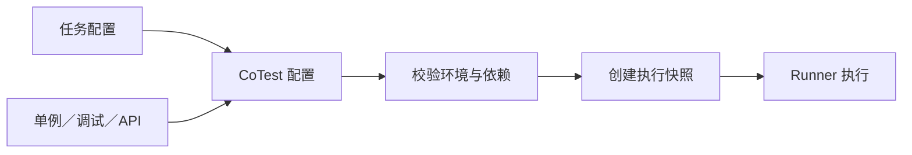

# CoTest 默认执行与公开失败分析导出

## 执行配置

任务创建、任务配置、顶栏单用例执行、普通／DDT 调试与版本执行 API 统一使用 CoTest Adapter。界面移除开关，参数名称、默认名称推导与环境 IP 配置保留。任务和单用例输入中的旧 `enabled` 布尔字段仅兼容旧客户端，始终归一为 `true`；浏览器调试草稿不再保存或读取关闭标记。

旧任务配置读取时归一为 CoTest，已经生成的批次与 assignment 快照保持原始含义，避免改变正在执行的 JVM、依赖和环境。日志重跑使用当前版本依赖；历史未记录环境的用例先填写本次 IP，不能自动回退成非 CoTest 执行。整批历史失败重跑没有运行时快照时明确提示从未通过用例创建任务并配置环境。缺少版本依赖、环境或不兼容节点时继续使用可操作的执行预检，不静默采用另一种执行方式。

## 公开导出

后台与公开执行详情使用同一个导出弹框、`/api/v1/run-batches/{id}/export` 与 Excel 生成器。公开访问支持 `results` 和 `failure-analysis`，覆盖指定轮次、全部轮次及最终结果；失败口径继续由服务端固定，客户端不能将通过用例混入失败模板。

公开失败分析清单包含失败堆栈、已有人工结论及证明链接。存在 AI 结论时，已有部分结论也导出，列仍位于失败堆栈之后；没有结论的行留空。标准公开结果继续沿用原字段范围。导出不授予编辑、认领、读取完整日志 ZIP 或证明附件的权限。

授权仍来自已持久化的批次公开记录，或绑定该批次的有效历史签名；未公开、已撤销、无效或跨批次链接均拒绝。匿名读取不能创建新的公开授权，复用已有批次的日志访问路径。用户在分享前需要确认分析内容可向持有链接的人公开。

Lite 与 Full 共享领域、契约和页面；SQLite／PostgreSQL 存储及日志后端不新增数据模型或依赖。导出继续分页读取、磁盘暂存并支持取消，不新增 Web 主线程中的全量用例读取。
